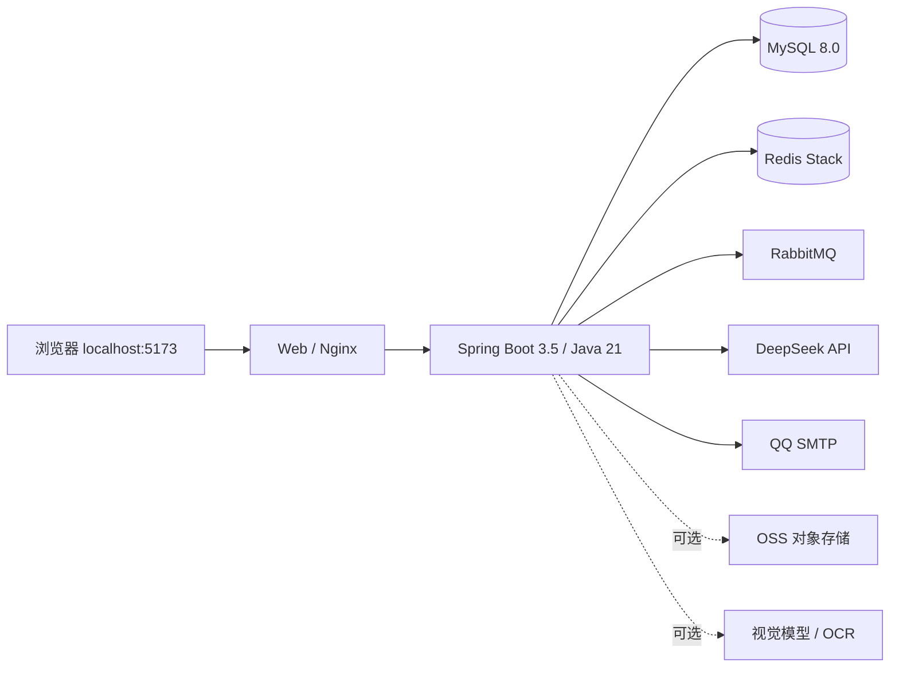

# MoodCopilot 本地部署、学习与发布清单

> 整理日期：2026-10-14  
> 本地目录：`D:\Agent开发\MoodCopilot`  
> 本地入口：`http://localhost:5173`  
> 个人仓库：`https://github.com/kh1ye/MoodCopilot`  
> 上游仓库：`https://github.com/Choco-emmm/MoodCopilot`

## 1. 当前结论

MoodCopilot 已在 Windows + Docker Desktop + WSL 2 环境完成本地部署，可作为一个可运行、可演示、可继续学习和二次开发的开源项目基线。

当前已经实测网页访问、用户登录和 DeepSeek 对话。完整生产发布、全部功能回归、移动端、视觉模型、对象存储和公网安全加固尚未完成，因此当前应表述为“完成本地容器化部署与核心链路验证”，不应表述为“独立完成原项目全部研发”。

## 2. 已完成并验证

- [x] 将上游项目克隆到 `D:\Agent开发\MoodCopilot`。
- [x] 安装并启用 WSL 2。
- [x] 将 Docker Desktop 主程序和 WSL 数据放在 D 盘。
- [x] Docker Engine 与 Docker Compose 可以正常使用。
- [x] 完成 `.env` 本地配置，且 `.env` 已被 Git 忽略。
- [x] 配置 MySQL 密码、JWT 密钥、DeepSeek API Key 和 QQ SMTP 参数。
- [x] 下载 MySQL、Redis、RabbitMQ、Java 21、Node、Nginx 和 Maven 镜像。
- [x] 使用 Maven + JDK 21 成功构建后端 JAR：
  `backend/moodcopilot/target/moodcopilot-backend-0.0.1-SNAPSHOT.jar`。
- [x] 新增 `docker-compose.local.yml`，配置本地端口并修正后端 JVM 内存参数。
- [x] MySQL、Redis、RabbitMQ、后端和 Web 前端容器成功启动。
- [x] MySQL、Redis、RabbitMQ 和后端健康检查通过。
- [x] 浏览器可以通过 `http://localhost:5173` 打开系统。
- [x] 页面登录成功。
- [x] DeepSeek 聊天能够返回有效内容。
- [x] 创建个人 GitHub 仓库并配置本地远程地址：
  - `origin`：个人仓库；
  - `upstream`：原作者仓库。
- [x] 本地部署配置已提交到 Git，提交为 `0c7bf08 Add local Docker Compose overrides`。

## 3. 当前系统结构



各组件职责：

| 组件 | 职责 |
|---|---|
| Vue 3 + Vite | 页面、路由、状态管理和用户交互 |
| Nginx | 提供前端静态文件，并将 `/api`、`/ws` 请求转发给后端 |
| Spring Boot | 登录、日记、聊天、长期记忆、社交和管理等业务逻辑 |
| MySQL | 长期保存用户、日记、聊天、记忆和业务数据 |
| Redis | 缓存、验证码、临时状态、限流和向量相关能力 |
| RabbitMQ | AI 等异步任务的排队、消费和失败重试 |
| DeepSeek | 生成聊天回复和部分 AI 分析结果 |
| QQ SMTP | 发送注册或找回密码等邮件验证码 |

## 4. 代码中已经具备的主要模块

以下模块已在代码、页面或接口中找到，但除已在第 2 节明确列出的项目外，尚未逐项完成端到端验证：

- [~] 用户注册、登录、JWT 鉴权、验证码和配额。
- [~] AI 流式聊天、深度思考、上下文引用和人格配置。
- [~] 日记创建、编辑、公开/私密设置和情绪分析。
- [~] 日记合集、排序和合集详情。
- [~] 长期记忆、候选记忆确认、证据来源和版本历史。
- [~] 日记知识图谱和记忆关联展示。
- [~] 成长报告、阶段总结和报告导出。
- [~] 重要事件、人生章节和时间线。
- [~] 情绪广场、关注、通知、举报和管理后台。
- [~] 音乐链接解析。
- [~] 图片上传、OCR 与视觉情绪分析。
- [~] Web 端和 `frontend-uniapp` 移动/小程序端代码。

## 5. 尚未完成或尚未验证

- [ ] 将当前新增提交成功推送到个人 GitHub；当前受本机 GitHub 网络/代理连接影响。
- [ ] 执行完整后端自动化测试。仓库中存在 21 个 Java 测试类，但本次只执行了跳过测试的 Maven 打包。
- [ ] 执行前端自动化测试和浏览器兼容性测试。
- [ ] 完整验证注册邮件、忘记密码和异常邮件场景。
- [ ] 完整验证日记、合集、广场、关注、举报、管理员等业务流程。
- [ ] 配置并验证 OSS 图片存储。
- [ ] 配置并验证视觉模型、OCR 和图片情绪分析。
- [ ] 配置并验证微信小程序的 `WX_APP_ID`、`WX_APP_SECRET`。
- [ ] 验证 RabbitMQ 的任务积压、失败重试和死信处理。
- [ ] 验证数据库备份、恢复和迁移流程。
- [ ] 完成公网服务器、域名、HTTPS、监控、日志和告警。
- [ ] 公网发布前限制 MySQL、Redis 等基础服务的宿主机端口访问。
- [ ] 公网发布前替换所有默认账号与默认密码，并重新审查 CORS、安全组和防火墙。

## 6. 日常启动和停止

### 启动

1. 启动 Docker Desktop，等待显示 `Engine running`。
2. 在 PowerShell 或 VS Code 终端执行：

```powershell
cd "D:\Agent开发\MoodCopilot"
docker compose -f docker-compose.yml -f docker-compose.local.yml up -d mysql redis rabbitmq backend web
```

3. 浏览器打开：

```text
http://localhost:5173
```

### 查看状态

```powershell
docker compose -f docker-compose.yml -f docker-compose.local.yml ps
```

### 查看后端日志

```powershell
docker compose -f docker-compose.yml -f docker-compose.local.yml logs --tail=100 backend
```

### 停止

```powershell
docker compose -f docker-compose.yml -f docker-compose.local.yml stop
```

不要执行 `docker compose down -v`，因为 `-v` 会删除 MySQL、Redis 和 RabbitMQ 等数据卷。

## 7. 修改代码后的重新构建

### 修改 Java 后端后

先重新生成 JAR：

```powershell
docker run --rm -v "D:\Agent开发\MoodCopilot\backend\moodcopilot:/workspace" -w /workspace maven:3.9-eclipse-temurin-21 mvn -DskipTests package
```

再重新构建并启动后端：

```powershell
docker compose -f docker-compose.yml -f docker-compose.local.yml up -d --build backend
```

### 修改 Web 前端后

```powershell
docker compose -f docker-compose.yml -f docker-compose.local.yml up -d --build web
```

## 8. 数据、密钥和 Git 边界

- 项目源码位于 `D:\Agent开发\MoodCopilot`。
- Docker 镜像、容器层和数据卷位于 Docker Desktop 的 WSL 数据盘。
- MySQL 等业务数据在 Docker 数据卷中，不在项目源码目录中。
- `.env` 包含数据库密码、JWT 密钥、API Key 和邮箱授权码，禁止提交到 GitHub。
- `target`、`node_modules` 等构建产物不作为主要源代码维护。
- 修改前先创建 Git 分支，完成后再提交，避免直接破坏可运行基线。
- 原项目采用 AGPL-3.0 协议。公开修改版时应保留许可证、上游来源和修改说明，并遵守对应开源义务。

## 9. 建议的学习顺序

1. **运行链路**：浏览器 → Nginx → Spring Boot → MySQL/Redis/RabbitMQ。
2. **用户链路**：注册 → 邮件验证码 → 登录 → JWT 鉴权。
3. **聊天链路**：前端发送 → 后端流式接口 → DeepSeek → 消息保存。
4. **日记链路**：创建日记 → 情绪分析 → MySQL 保存 → 页面展示。
5. **记忆链路**：日记/聊天 → 候选记忆 → 用户确认 → 长期记忆检索。
6. **异步链路**：后端生产任务 → RabbitMQ → 消费者执行 → 状态更新。
7. **工程链路**：测试、日志、备份、配置隔离、Docker 构建和 Git 分支。

建议先完成一个小型、可验证的个人改动，例如新增一个设置项、调整聊天页面或增加一个查询接口，再逐步进入长期记忆和异步任务模块。

## 10. 项目介绍模板

### 简短版本

基于开源 MoodCopilot 完成 Windows + WSL 2 + Docker Compose 本地部署，打通 Vue 3、Spring Boot、MySQL、Redis、RabbitMQ、DeepSeek 和 QQ SMTP 组成的核心链路；完成后端 Maven 构建、本地容器编排和运行参数适配，并在此基础上继续进行功能学习与二次开发。

### 面试时需要明确的边界

- 原始业务代码来自 MoodCopilot 开源项目。
- 当前个人完成的是环境搭建、依赖配置、后端构建、Docker 编排适配、核心链路验证和后续二次开发准备。
- 后续自己实际修改并验证的功能，应单独记录“问题、方案、代码改动、测试结果”，再作为个人贡献介绍。

## 11. 下一阶段清单

1. 解决 GitHub 网络连接并推送当前提交。
2. 建立个人开发分支，例如 `dev` 或 `feature/first-change`。
3. 选择一个小功能，阅读前端页面、后端 Controller、Service 和数据库表的完整链路。
4. 为该功能完成一次修改、重新构建和回归验证。
5. 记录架构图、关键接口、数据流和个人改动，形成可用于简历和面试的项目说明。
6. 本地版本稳定后，再准备云服务器、域名、HTTPS 和公网安全配置。
